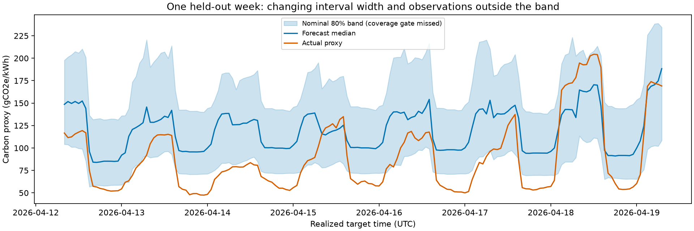
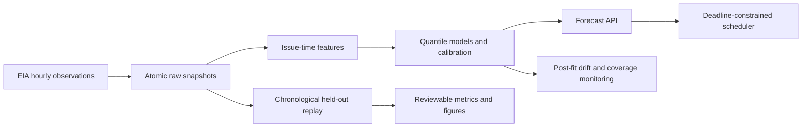

# Carbon-Aware Energy Scheduler

Want a visual interface? Run the [local Streamlit dashboard](docs/dashboard.md)
for forecast charts, job scheduling, CSV export and monitoring status.

[](https://github.com/vijiniwijerathna322-ctrl/carbon-aware-scheduler/actions/workflows/ci.yml)

Forecast grid demand and carbon intensity, then schedule flexible jobs with honest uncertainty.
Implementation follows the [master plan](plans/2026-10-11-00-master-plan.md).



Flexible loads can choose when to run. This project connects hourly forecasts to
that decision, compares against immediate execution and a hindsight oracle, and
keeps failed uncertainty checks visible.

| Measured CISO result | Value | Evidence |
|---|---:|---|
| Demand held-out coverage (nominal 80%) | 77.35% — gate pass | [CQR results](docs/results/backtest-cqr.md) |
| Carbon held-out coverage (nominal 80%) | 71.57% — gate fail | [CQR results](docs/results/backtest-cqr.md) |
| Median / upper mean scenario savings | 29.37% / 27.35% | [Scheduling replay](docs/results/schedule-backtest.md) |
| Hindsight oracle mean scenario savings | 33.17% | [Scheduling replay](docs/results/schedule-backtest.md) |

Figures and [summary metrics](docs/results/portfolio-summary.json) are regenerated
from [committed evaluation inputs](docs/results/figure-inputs/README.md) using
`uv run python scripts/make_figures.py`; no API key is needed.
See the [model card](docs/model_card.md), [datasheet](docs/datasheet.md) and
[CV/interview wording](docs/cv_bullets.md) for intended use and limitations.



## Offline API demo

See the [64-second native API walkthrough](docs/demo/native-walkthrough.gif),
generated from real endpoint responses. It is explicitly labelled as a rendered
walkthrough. A [65-second scripted Chromium/container recording](docs/demo/browser/README.md) now shows the published research image and real API responses.

The tracked demo serves real CISO models without an EIA key. With Docker installed:

```bash
docker build -t carbon-scheduler:demo .
docker run --rm --read-only --tmpfs /tmp --cap-drop ALL -p 127.0.0.1:8000:8000 carbon-scheduler:demo
```

Open [interactive API docs](http://localhost:8000/docs). From a second Bash shell:

```bash
curl --fail 'http://localhost:8000/v1/forecast?region=CISO&horizon=1'
curl --fail -H 'Content-Type: application/json' \
  -d '{"duration_hours":2,"power_kw":7,"deadline":"2026-10-12T06:00:00Z"}' \
  'http://localhost:8000/v1/schedule'
```

The verified native demo forecast returns:

```json
{"region":"CISO","target":"carbon_intensity_g_per_kwh","issue_time":"2026-10-11T06:00:00Z","data_as_of":"2026-10-11T06:00:00Z","model_version":"20261012T115113Z-438177c1","alpha":0.2,"points":[{"target_time":"2026-10-11T07:00:00Z","horizon":1,"lower":248.42437793177538,"median":260.8126065770477,"upper":301.2394968001054}]}
```

The schedule response includes:

```json
{
  "recommendation": {
    "start": "2026-10-11T18:00:00Z",
    "end": "2026-10-11T20:00:00Z",
    "strategy": "median",
    "emissions_gco2_median": 2271.0566576815477,
    "emissions_gco2_lower": 1815.2590382689416,
    "emissions_gco2_upper": 2601.134505879341,
    "baseline_start": "2026-10-11T07:00:00Z",
    "baseline_emissions_gco2_median": 3656.136396335312,
    "expected_savings_pct": 37.88369985436221,
    "delay_hours": 11,
    "hours": null
  },
  "forecast_issue_time": "2026-10-11T06:00:00Z",
  "data_as_of": "2026-10-11T06:00:00Z",
  "model_version": "20261012T115113Z-438177c1",
  "notes": [
    "Carbon G4 missed nominal coverage; summed endpoints are not job-level confidence bounds.",
    "Demo uses a frozen historical snapshot; times are relative to its forecast issue."
  ]
}
```

These are frozen historical timestamps and expected emissions, not current forecasts
or realized savings. Carbon's nominal interval-coverage gate remains a miss.
Native demo checks and GitHub Linux/Docker CI passed. The development machine
still has no local Docker runtime; the clean Linux CI runner verified the image. See
[verification status](docs/results/api-demo.md). Run `bash scripts/smoke_docker.sh`
on a Docker host to verify the non-root, read-only image.

To run the same API natively on Windows after `uv sync`:

```powershell
$env:CARBON_DATA_DIR="demo/data"
$env:CARBON_MODELS_DIR="demo/models"
$env:DEMO_MODE="1"
uv run uvicorn carbon_scheduler.api.main:app --host 127.0.0.1 --port 8000
```

Endpoints include `/healthz`, `/v1/forecast`, `/v1/schedule` and `/v1/models/current`.
Outside demo mode, target data older than `MAX_DATA_AGE_HOURS` (default 6) returns
503 `data_stale`. Models and raw history are loaded once; restart after refreshing
them. Forecast horizons are 1–48 hours. Schedule arrivals default to the first
forecast hour; past arrivals are clamped with a note, while deadlines outside the
forecast window return 422. Only CISO is served in this MVP.

## Development

Use Python 3.11 or 3.12 and uv. Run `uv sync`, then `make check`.
On Windows without make, run `uv run ruff check .`, `uv run ruff format --check .`,
`uv run mypy src`, and `uv run pytest -q`.
Copy `.env.example` to `.env` for local configuration; never commit API keys.
Run `uv run carbon-scheduler --help` or `uv run carbon-scheduler version`.
Defaults and relative directory overrides resolve against the project root; absolute
`CARBON_DATA_DIR` and `CARBON_MODELS_DIR` overrides are also supported.
Live tests are excluded by default; explicitly select them with `uv run pytest -m live`.

## Ingest hourly data

Set `EIA_API_KEY` in the ignored project `.env`, then run:

```powershell
uv run carbon-scheduler ingest --region CISO --start 2021-01-01T00
```

Long histories are fetched in adjacent calendar-year windows to keep API queries bounded.
Completed windows are checkpointed as raw observations. If a later request fails,
rerun the same command to resume with a 48-hour overlap. Cleaned interim output and
its quality report update after the entire requested interval succeeds. Historical
backfills before the existing cache start update raw only after full success, so
an interrupted backfill retries its older prefix safely.

`--end YYYY-MM-DDTHH` optionally limits the inclusive UTC interval. Raw observations and cleaned interim Parquet files live under
`data/<stage>/CISO/`; the interim directory also
contains `quality-report.json`. Reruns refresh a 48-hour overlap; revised nulls remain
missing. The CLI prints cleaning counts and G2 status. G2 requires less than 2% of
hours incomplete across the four core series; fuel completeness is reported separately. G2 failure exits with code 2 and retains
the data for inspection.

Live verification on 2026-10-12 covered 2021-01-01 00:00 through 2026-10-12
05:00 UTC: 50,646 hourly rows, 623 incomplete core hours (1.2301%), and G2 passed.
An identical 48-hour-overlap rerun preserved the raw/interim Parquet and quality
report bytes. Fuel coverage remains separate: GEO first appears on 2025-12-16
09:00 UTC, and missing historical observations are retained rather than inferred.

The full-history live check is explicitly opt-in and downloads into a temporary directory:

```powershell
uv run pytest tests/ingest/test_live.py -m live --no-cov
```

## Build the carbon dataset

After ingestion, run `uv run carbon-scheduler build-dataset --region CISO`.
This offline command writes `data/processed/CISO/hourly.parquet` and
`carbon-quality-report.json` without requiring an API key. Use `--factors-path`
to select another validated factors file; relative paths resolve from the project root.
Equal reruns preserve both files' bytes and modification times.

Intensity is a lifecycle proxy for observed positive generation with configured
factors. Storage, unknown fuels and heterogeneous OTH are excluded; imports are
not attributed. Missing fuel observations remain missing. The output includes
covered/excluded generation, observed coverage, missing included fuel-cell counts
and negative generation counts. Observed coverage does not measure unobserved
generation. The report records factors, citations, absent fuel codes and input digests.
See [ADR 0001](docs/adr/0001-generation-based-intensity.md).

The [executed EDA notebook](notebooks/01_eda.ipynb) includes local-calendar profiles,
missingness and distributions. Regenerate it from the project root with:

```powershell
uv sync --group eda
uv run --group eda python scripts/build_eda_notebook.py
```

The 50,646-hour snapshot has mean intensity 237.16 gCO2e/kWh and 47 missing
intensity hours. Its 29.37–449.03 range reflects changing observed fuel mixes.
43,472 hours have partial included-fuel observations, largely because GEO appears
late; these values must not be described as complete whole-grid carbon intensity.

## Forecast backtests

Run offline rolling-origin comparisons on the latest six calendar months:

```powershell
uv run carbon-scheduler backtest --region CISO --target demand_mwh --model naive
uv run carbon-scheduler backtest --region CISO --target demand_mwh --model lgbm
uv run carbon-scheduler backtest --region CISO --target carbon_intensity_g_per_kwh --model naive
uv run carbon-scheduler backtest --region CISO --target carbon_intensity_g_per_kwh --model lgbm
uv run python scripts/summarize_point_backtests.py
```

Reports and prediction Parquet files go to `reports/`; `--reports-dir` overrides
that directory. The final comparison is written to `docs/results/backtest-point.md`.
Forecasts cover horizons 1–48, with daily region-local midnight issues and refits
every 30 local calendar days. LightGBM uses fixed seed 42 and one CPU thread.

Backtests default to raw observations, preserving gaps and avoiding the future
information used by retrospective cleaning. They still use latest revisions and
assume zero observation latency. `--data-source processed` enables exploratory
retrospective results and does not establish leakage-safe performance. Point
scores compare identical forecast rows for G3; reports also show per-model
availability and uncalibrated interval metrics. See [ADR 0005](docs/adr/0005-chronological-raw-backtest.md).

The [first six-month results](docs/results/backtest-point.md) pass G3 in every
horizon bucket for both targets. Paired overall median MAE improved by 53.35%
for demand (2,690.36 → 1,255.11 MWh) and 38.49% for carbon intensity
(43.98 → 27.05 gCO2e/kWh). Raw interval coverage is 73.17% and 58.83%,
respectively; these intervals still need Plan 05 calibration.

## Calibrated models and registry

```powershell
uv run carbon-scheduler backtest --region CISO --target demand_mwh --model cqr
uv run carbon-scheduler backtest --region CISO --target carbon_intensity_g_per_kwh --model cqr
uv run python scripts/summarize_cqr_backtests.py
uv run carbon-scheduler train --region CISO
```

Training uses raw pointwise targets, reserves the final 90 days for calibration,
and saves unique local versions under `models/CISO/<target>/`. `current.json`
selects each target's current version. `--fit-end` optionally selects an aware
timestamp (naive timestamps mean UTC). Defaults use each target's last finite
observation. Reloaded predictions are verified against the fitted model.
Artifact metrics describe reused calibration data and are labelled accordingly.

The [held-out CQR results](docs/results/backtest-cqr.md) show demand coverage
**77.35% (G4 pass)** and carbon coverage **71.57% (G4 fail)**. Carbon's 7–24h
bucket is 69.68%, below its 70% target. Both CQR medians still beat the weekly
baseline in every bucket. The original results are retained without test-period
tuning; [ADR 0013](docs/adr/0013-carbon-coverage-gate-miss.md) documents the miss.
Carbon intervals must not be advertised as validated nominal 80% bounds.

## Scheduling replay

After producing the raw CQR carbon backtest, run:

```powershell
uv run carbon-scheduler schedule-backtest --region CISO
```

The command writes both strategies' summaries and per-job results to
`reports/schedule_backtest_CISO.md` and `.parquet`. `--reports-dir` selects the
directory containing the CQR prediction file and provenance sidecar. See the
[recorded replay results](docs/results/schedule-backtest.md) for measured savings,
oracle comparisons and excluded scenarios.

The six-month replay scored 2,726 scenarios per strategy: mean realized savings
were 29.37% for median and 27.35% for upper, versus the 33.17% hindsight oracle.
G5 passed; 19 scenarios with incomplete actual windows were excluded. These are
equally weighted scenario percentages, not an estimate for a real fleet.

The optimizer supports contiguous and interruptible jobs, UTC whole-hour starts,
deadline constraints, and median/upper objectives. Replay uses illustrative 7 kW
EV scenarios arriving at daily local midnight, with the issue-hour observation
available under zero observation latency. Upper endpoints are an uncertainty
heuristic, not a validated job-level confidence bound. See
[ADR 0014](docs/adr/0014-scheduling-and-replay.md).

## Weather extension

Weather data: [Open-Meteo](https://open-meteo.com/), CC BY 4.0; its public API is
for non-commercial use. Plan 08 uses cached UTC temperature, cloud cover,
shortwave radiation and 100 m wind at three illustrative CISO locations.
The [weather ablation](docs/results/ablation-weather.md) uses realized archive
weather and is explicitly exploratory: it cannot prove improvement with live
forecasts. Production and the shipped demo retain weather-free models.
Optional approved variants fall back to the baseline with response `notes` when
weather is unavailable, incomplete or newer than the reported issue time.
See [ADR 0016](docs/adr/0016-weather-provenance-and-fallback.md) for the deployment
contract and remaining vintage-data requirement.

After producing the raw-target CQR backtest reports, reproduce the experiment:

```bash
uv run python scripts/probe_open_meteo.py
uv run python scripts/ablation_weather.py --reuse-baseline
```

The second command verifies the saved baseline cohort and fits weather variants
with the same 400-tree, seed-42 configuration. It downloads annual cached weather
ranges, then performs seven chronological refits per target; this is a substantial
local computation. Reports remain under `reports/`, and the published comparison
is written to `docs/results/ablation-weather.md`.
Once both prediction files exist, add `--reuse-weather` to regenerate the report
without repeating the weather fits; weather and baseline provenance are checked.

## Monitoring

```powershell
uv run carbon-scheduler monitor --region CISO
```

Writes self-contained `reports/monitor_CISO.html` and strict JSON. Set
`CARBON_REPORTS_DIR` or `--reports-dir` to select the report directory, which also
contains the earlier CQR backtest baseline. Exit code 2 means an alert; 0 means
ok, warn or insufficient data; 1 means a command failure.
`GET /v1/monitoring/status?region=CISO` serves the latest saved JSON, returning
404 with `{"error":"no_report"}` until a report exists (including the baked demo).

Replay scores only issues at or after the deployed artifact's fit cutoff. Newly
fitted models can therefore have insufficient realized coverage data. Input
drift, excluded observations and provenance remain visible. Approved weather
variants require forecast-vintage logs before replay monitoring is supported.
See the [CISO snapshot](docs/results/monitoring-ciso.md),
[30% shift simulation](docs/results/drift-simulation.md) and
[diagnostic limitations](docs/adr/0017-monitoring-cutoffs-and-diagnostics.md).

Region metadata is configurable through `CARBON_REGIONS_PATH` (default
`config/regions.yaml`). Commands without `--region` use its first entry; API
requests without a region use the region served by the service. ERCO is configured
in `America/Chicago`. Its [execution record](docs/results/second-region-erco.md)
records real ERCO forecasting, matched seasonal-naive comparisons, scheduling replay and monitoring diagnostics. Demand MAE improved 40.69%, carbon MAE 38.32%; demand coverage missed G4. No ERCO candidate was promoted.

The [weekly refresh workflow](.github/workflows/refresh.yml) runs both regions
without retraining. It preserves monitoring failures, uploads diagnostics and
opens an issue when monitoring fails. See [refresh operations](docs/automation-refresh.md)
for the EIA secret, reviewed model/baseline artifact contract and repository
variables required before a live dispatch. The schedule starts after this workflow
reaches the default branch; Plan 10 is still in progress.

The [manual retrain workflow](.github/workflows/retrain.yml) creates a draft PR
with versioned candidate artifacts and paired held-out metric deltas. It runs
the quality gate before opening review and leaves deployment pointers unchanged.
See [retraining operations](docs/automation-retrain.md) for comparison limits,
repository permissions and the separate promotion requirement.

The [container release workflow](.github/workflows/release.yml) reruns the full
CI gate on stable `v*` tags already merged into main. It smoke-tests the exact
image before publishing and verifies the GHCR digest before updating `latest`.
Weekly Dependabot updates cover uv and GitHub Actions. See
[release operations](docs/automation-release.md). The approved [v0.2.0 research release](https://github.com/vijiniwijerathna322-ctrl/carbon-aware-scheduler/releases/tag/v0.2.0) is published with the existing CISO demo; coverage and production acceptance limitations remain explicit.

## Scope, attribution and licence

Carbon intensity is an average observed-generation lifecycle proxy, excludes
unresolved other/storage categories and ignores imports. It is not a marginal
emissions estimate. Latest revisions and zero observation latency limit historical
replay; serial dependence and drift limit conformal coverage guarantees. Savings
describe equally weighted illustrative jobs, not a measured production fleet.
ERCO measurements are retained; production acceptance and model promotion remain pending. The live CISO refresh alert path uploaded diagnostics and opened issue 8, preserving the monitor failure.

EIA, Open-Meteo, IPCC AR5 and the separate POST oil-factor source retain their
attributions and terms; see the datasheet and factor config. [MIT](LICENSE)
applies to project code and does not relicense external data or publications.

The roadmap is to complete live regional/automation acceptance, collect observation
and weather publication vintages, evaluate new calibration choices on a fresh
cohort, and test fleet-specific workloads with defensible marginal-emissions data.

## Project structure

- `src/carbon_scheduler/`: ingestion, carbon proxy, issue-time features, models, scheduler, API and monitoring.
- `config/`: region definitions and attributed emission factors.
- `demo/`: bounded byte-checked offline snapshot and selected artifacts.
- `scripts/`: experiments, bundle preparation, figures and native demo capture.
- `docs/`: result sources, model card, datasheet, ADRs and write-up.
- `.github/workflows/`: CI and review-oriented operational workflows.

Read the [project write-up](docs/writeup.md) and [architecture decision index](docs/adr/README.md) for design rationale.
