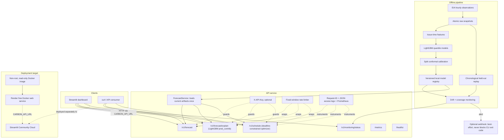

# Architecture

This expands the small diagram in the README with the full request path,
including the API hardening and explainability work from
[ADR 0019](adr/0019-api-authentication-rate-limiting-and-observability.md) and
[ADR 0020](adr/0020-model-explainability.md).

## Request path (one call)

1. Client sends `GET /v1/forecast?region=CISO&horizon=6` (or `/explain`, or
   `POST /v1/schedule`).
2. `RateLimitMiddleware` checks the per-key/per-IP fixed-window budget first
   (`api/rate_limit.py`); over budget returns 429 before anything else runs.
3. `ObservabilityMiddleware` assigns/propagates a request id, times the
   request, and records Prometheus counters/histograms (`api/metrics.py`).
4. The `v1_router`'s `require_api_key` dependency (`api/security.py`) checks
   `X-API-Key` against `API_KEYS` — a no-op when that setting is unset.
5. The route handler (`api/routes.py`) calls into `ForecastService`
   (`api/service.py`), which holds the already-loaded, already-validated
   model artifacts and precomputed forecast frames from startup — no
   per-request disk I/O or retraining.
6. For `/explain`, `ForecastService.explain` reuses the same loaded
   `ForecastModel` and its historical `series` to call
   `models/explain.py`'s `explain_forecast`, which ranks LightGBM's native
   TreeSHAP contributions.
7. Response schemas (`api/schemas.py`) validate and serialize the result;
   `ServiceUnavailableError`/generic exception handlers in `api/main.py`
   sanitize any failure before it reaches the client.

## Why this shape

- **No per-request model loading or training**: `ForecastService.__init__`
  does all of that once at startup, so request latency is just feature
  lookup + prediction, verified by the health check.
- **Middleware order matters**: rate limiting runs before auth so an
  unauthenticated flood is still bounded, and before the route handler so a
  limited request never reaches business logic.
- **Fail-safe monitoring**: a webhook failure is logged and reported, never
  raised — the CLI's exit code (2 for `alert`) is the one contract downstream
  automation (`.github/workflows/refresh.yml`) actually depends on.
- **Dashboard/API separation**: the Streamlit app only ever speaks HTTP to
  the API (`CARBON_API_URL`), so they can be deployed to two different free
  hosts independently (see the [deployment guide](deployment.md)).
